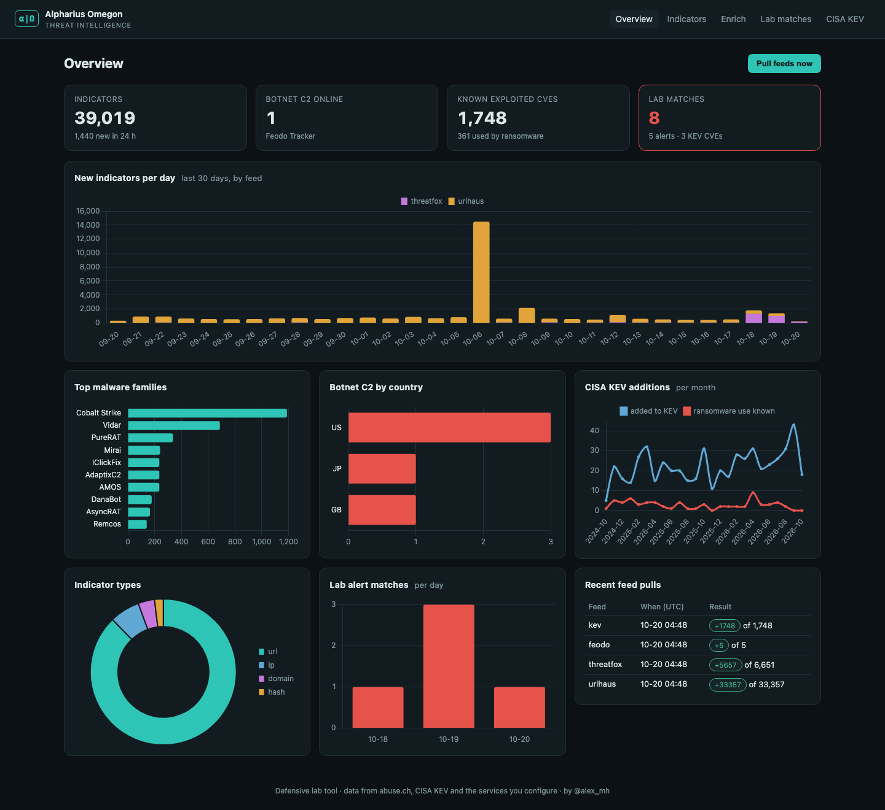
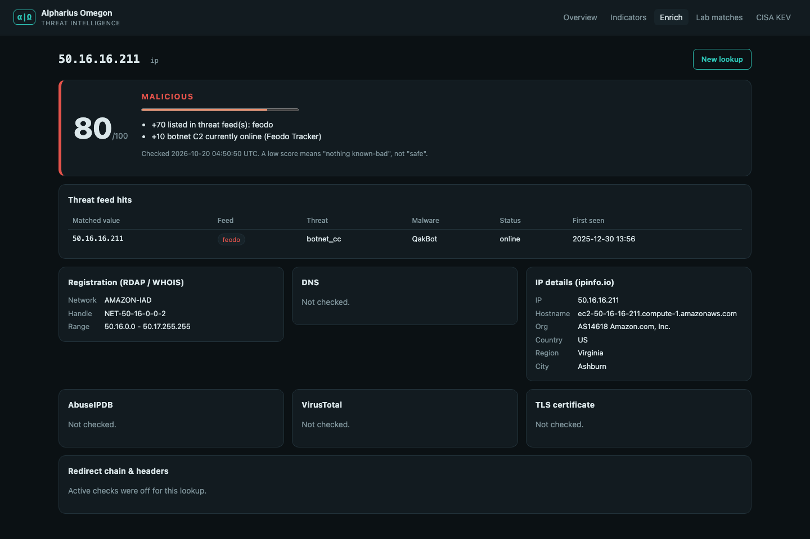
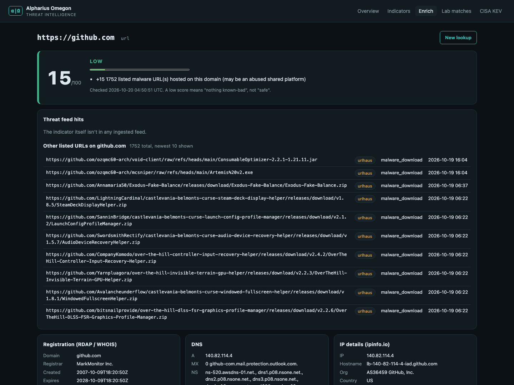
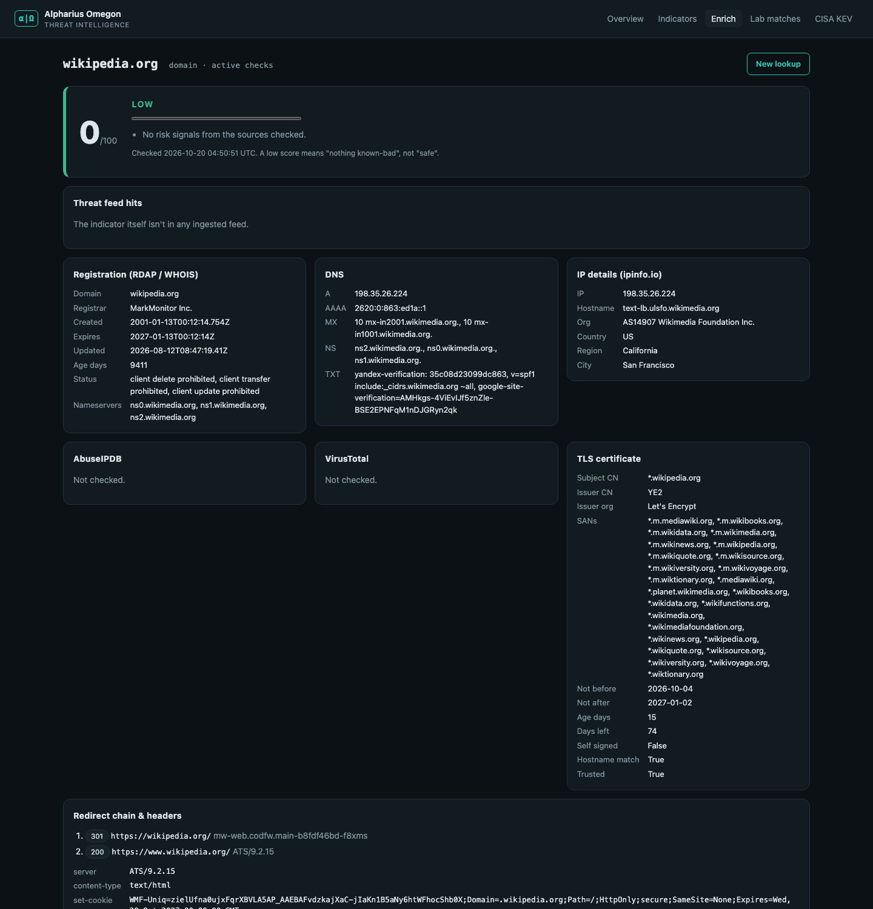
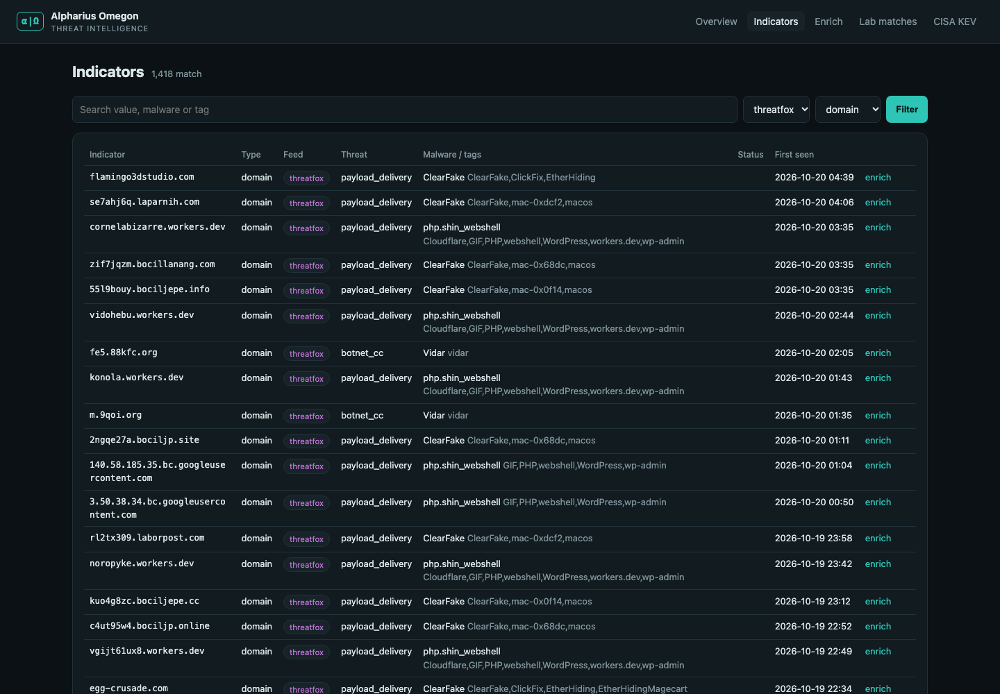
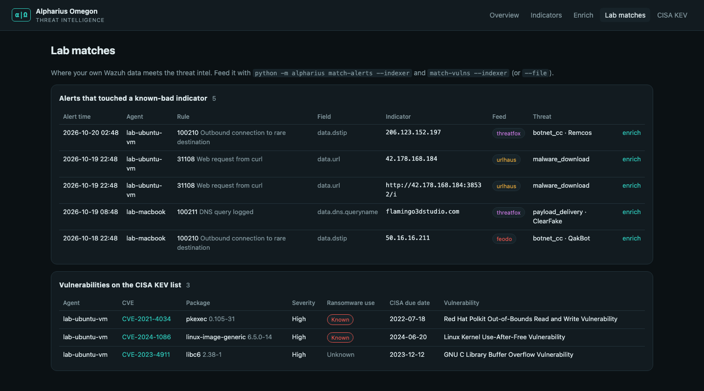

# alpharius-omegon

**Open-source threat intelligence dashboard. It collects public threat feeds, enriches suspicious indicators, and checks them against your own Wazuh lab.**

Author: @alex_mh · Part of the [TrifoldPathSec](https://github.com/TrifoldPathSec) home-lab portfolio

---

## What it does

Alpharius Omegon answers three questions a SOC analyst asks every day:

1. **What's out there right now?** It pulls four free public feeds into SQLite: malware URLs, botnet C2 servers, malware hashes and actively exploited CVEs. It then charts the trends.
2. **Is this indicator bad?** Paste an IP, domain, URL or file hash, defanged or not. It's checked against the feeds, RDAP/WHOIS, DNS, ipinfo.io and, optionally, AbuseIPDB and VirusTotal, and it gets an explainable 0–100 score.
3. **Did any of it touch my lab?** It pulls IPs, domains and URLs out of Wazuh alerts and flags any that are on a feed. It also checks Wazuh's vulnerability findings against the CISA KEV catalog, so you see which CVEs on your machines are being exploited in the wild.

```
  abuse.ch URLhaus ─┐
  abuse.ch ThreatFox ┼─ ingest ──▶ SQLite ◀── match ── Wazuh indexer (alerts + vulnerability states)
  Feodo Tracker ─────┤               │                     or exported alerts.json
  CISA KEV ──────────┘               │
                                     ├──▶ Flask dashboard + Chart.js trends
  RDAP · DNS · ipinfo ─┐             │
  AbuseIPDB · VT  ─────┼─ enrich ────┘    (lookups stored with full evidence)
  redirects · TLS* ────┘
                                         * active checks, opt-in
```

## Screenshots

All screenshots are from a live run against the real feeds on 2026-10-20. The Wazuh alerts and vulnerability findings on the *Lab matches* page are **synthetic demo data** (see [Try it](#try-it)), not output from a real lab.

### Overview: feed trends at a glance



### Enrichment with an explainable score

| Online QakBot C2 from Feodo Tracker (80) | github.com: hosts 1,752 listed URLs, but it's a shared platform (15) |
|---|---|
|  |  |

| Active checks: RDAP, DNS, ipinfo and the TLS certificate | Indicator browser with filters |
|---|---|
|  |  |

### Lab matches: where the intel meets your Wazuh data



## Data sources

| Source | What it gives | Key needed |
|---|---|---|
| [URLhaus](https://urlhaus.abuse.ch/) (abuse.ch) | Malware distribution URLs from the last 30 days | No (optional `ABUSECH_AUTH_KEY`) |
| [ThreatFox](https://threatfox.abuse.ch/) (abuse.ch) | C2 IPs, domains, URLs and payload hashes, tagged by malware family | No (optional) |
| [Feodo Tracker](https://feodotracker.abuse.ch/) (abuse.ch) | Botnet C2 servers (QakBot, Emotet, etc.) with online status and country | No |
| [CISA KEV](https://www.cisa.gov/known-exploited-vulnerabilities-catalog) | CVEs exploited in the wild, with ransomware use and due dates | No |
| [rdap.org](https://rdap.org/) | Registration data (the modern WHOIS): registrar, creation date, domain age | No |
| [ipinfo.io](https://ipinfo.io/) | ASN, hosting provider, location | No (`IPINFO_TOKEN` raises the rate limit) |
| [AbuseIPDB](https://www.abuseipdb.com/) | Community abuse confidence score | `ABUSEIPDB_API_KEY` |
| [VirusTotal](https://www.virustotal.com/) | Multi-engine verdicts | `VIRUSTOTAL_API_KEY` |

The abuse.ch feeds are used under their [terms of use](https://abuse.ch/terms-of-use/). They're free for non-commercial use.

## Scoring

Every point comes with a written reason, so analysts can see *why*, not just the number.

| Signal | Points |
|---|---|
| Indicator (or the URL's host) is listed in a feed | +70 |
| ↳ and it's a Feodo C2 that's online right now | +10 |
| Not listed itself, but listed malware URLs are served **from this IP** | +40 |
| Not listed itself, but listed malware URLs are hosted **on this domain** | +15 |
| AbuseIPDB confidence ≥ 75% / ≥ 25% | +40 / +20 |
| VirusTotal: ≥ 3 engines malicious / 1–2 malicious / suspicious only | +50 / +25 / +10 |
| Domain registered < 30 days ago / < 180 days ago | +25 / +10 |
| TLS: self-signed or untrusted / name mismatch / issued < 7 days ago | +10 / +15 / +10 |
| ≥ 3 redirects / redirects to a different domain | +10 / +5 |

**≥ 70 malicious · 30–69 suspicious · < 30 low.** "Low" means "nothing known-bad", not "safe".

The "hosted on this domain" rule exists because of a false positive found during testing. URLhaus lists 1,700+ malware URLs on `github.com`, and the first version scored GitHub as malicious. Now an exact listing counts fully, a listing on a bare IP counts strongly, and a listing on a shared domain only nudges the score. The Wazuh matcher uses the same rule, so a DNS query for `github.com` doesn't raise a lab alert.

## Security design

This is a tool that handles hostile input, so it's built defensively:

- **Active checks are opt-in.** By default nothing contacts the indicator's own infrastructure. The *active checks* box follows redirects and reads the TLS certificate. It sends `GET`s with `stream=True`, reads only the headers, never downloads bodies and never runs JavaScript.
- **SSRF guard.** Before every hop, including each redirect, the host is resolved and refused if any address is private, loopback, link-local or reserved. A phishing URL can't redirect the tool into `127.0.0.1` or your LAN. *(A DNS-rebinding race is still possible in theory. The tool runs on loopback for one analyst, so that's accepted.)*
- **Bound to 127.0.0.1**, with no login, because it's a single-analyst lab tool. Don't expose it.
- **CSRF token** on every POST, `SameSite=Strict` session cookie, and a strict **Content-Security-Policy** (no inline scripts: chart data is a JSON block read by a static script).
- **Indicators are rendered as text, never as links.** Feed `reference` links only render when they start with `http(s)://`. Jinja autoescaping covers everything else.
- **Secrets stay in `.env`** (git-ignored). The abuse.ch key is only sent to abuse.ch hosts, and a test checks that.
- **Wazuh access should be a read-only indexer user**, with TLS verified against your wazuh-docker `root-ca.pem`.

## Quick start

Requires Python 3.9+.

```bash
git clone https://github.com/TrifoldPathSec/alpharius-omegon.git
cd alpharius-omegon
python3 -m venv .venv && source .venv/bin/activate
pip install -r requirements.txt
cp .env.example .env              # optional: add API keys
python -m alpharius ingest        # pulls ~40k indicators + 1.7k KEV entries in a few seconds
python -m alpharius serve         # http://127.0.0.1:5001
```

Command line:

```bash
python -m alpharius enrich 'hxxps://login-portal[.]example/verify'   # defanged input is fine
python -m alpharius enrich suspicious.example --active --json
python -m alpharius match-alerts --indexer --hours 24
python -m alpharius match-vulns --indexer
```

To keep the intel fresh, schedule `ingest` with cron or launchd. Be polite to the free feeds: hourly is plenty.

## Connect it to Wazuh

Set the indexer details in `.env`:

```ini
WAZUH_INDEXER_URL=https://<wazuh-host>:9200
WAZUH_INDEXER_USER=<read-only-user>
WAZUH_INDEXER_PASSWORD=<password>
WAZUH_INDEXER_VERIFY=config/root-ca.pem     # copied from wazuh-docker's certs
```

- `match-alerts --indexer` queries `wazuh-alerts-*` for the last N hours. It extracts public IPs, URLs and domain fields from `data.*` and `full_log`, skips private addresses, and records every hit.
- `match-vulns --indexer` queries `wazuh-states-vulnerabilities-*` (Wazuh 4.8+) and keeps the CVEs that are on the KEV list. Ransomware-linked CVEs are sorted first.

No indexer access? `--file` accepts `alerts.json` (JSON lines from `/var/ossec/logs/alerts/`), a JSON array, or a saved `_search` response.

## Try it

You can try it without a Wazuh lab using synthetic data:

```bash
python -m alpharius ingest
python scripts/make_demo_alerts.py                     # builds fake alerts that reference real, fresh indicators
python -m alpharius match-alerts --file samples/demo-alerts.jsonl
python -m alpharius match-vulns  --file samples/demo-vulns.json
python -m alpharius serve
```

## Tests

```bash
pip install -r requirements-dev.txt
python -m pytest -q        # 52 tests, fully offline (HTTP, DNS and TLS are faked)
```

The tests cover the feed parsers, upsert idempotency, one failing feed not stopping the others, defang/classify, RDAP walk-up to the registered domain, the scoring rules, the github.com false-positive case, redirect-chain handling with relative `Location` headers, the SSRF guard (including a redirect into `127.0.0.1`), TLS certificate parsing with a generated self-signed cert, wildcard hostname matching, Wazuh alert and KEV matching across both vulnerability formats, CSRF rejection and HTML escaping.

## Project layout

```
alpharius/
  feeds.py        URLhaus, ThreatFox, Feodo, KEV: parsers + ingest
  enrich.py       classify/refang, passive + active enrichment, SSRF guard, scoring
  wazuh.py        alert observable extraction, alert + KEV matching, indexer client
  db.py           SQLite schema + chart queries
  web.py          Flask app (CSRF, CSP, pages)
  __main__.py     CLI
  templates/      Jinja pages
  static/         CSS + Chart.js wiring
scripts/make_demo_alerts.py
samples/demo-vulns.json
tests/            pytest + offline fixtures
```

## Limitations

- The registrable-domain check is a heuristic, not the full Public Suffix List.
- There's no authentication, by design for a loopback lab tool. It would need auth before living anywhere shared.
- Feodo Tracker's blocklist only lists recent C2s, so the country chart is small on quiet days.
- Free API tiers have rate limits. Failures show up per section instead of failing the whole lookup.

## Roadmap

- Send URLs flagged by [sharrowkyn-phishing-analyzer](https://github.com/TrifoldPathSec/sharrowkyn-phishing-analyzer) straight into enrichment.
- Export matched indicators as a Wazuh CDB list, so the SIEM alerts on them natively.
- Add an optional AlienVault OTX pulse feed.
- Add STIX 2.1 export for lookups.

## Name

Alpharius and Omegon are the Alpha Legion's twin primarchs: two sources that look like one. This tool does the same with intel, taking many feeds and presenting a single picture.

## License

MIT. See [LICENSE](LICENSE).
